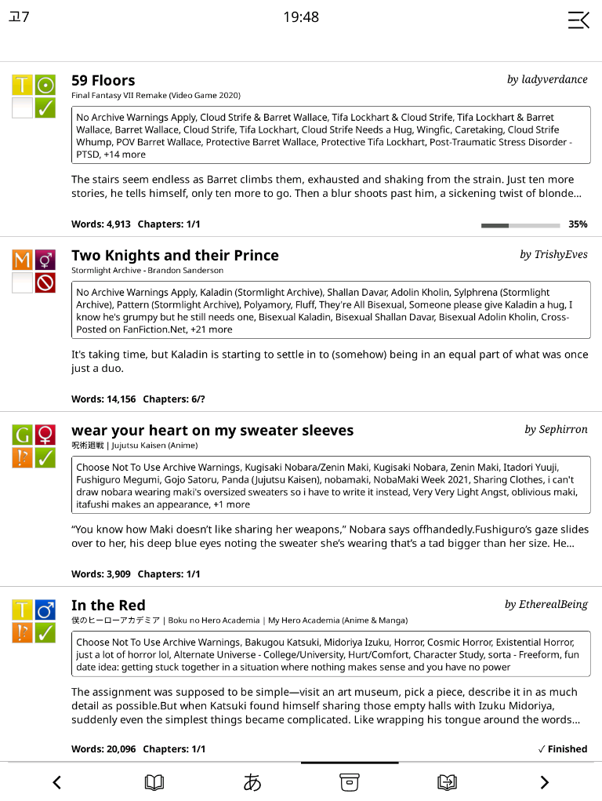
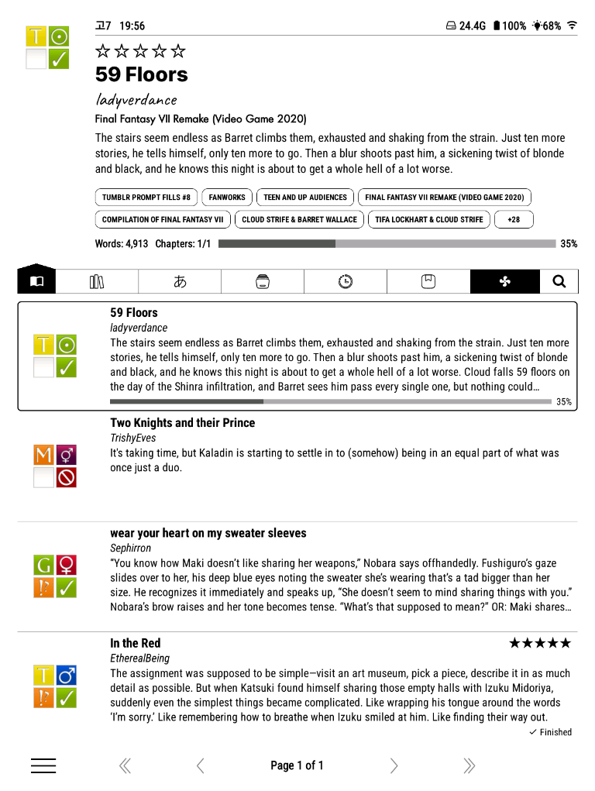
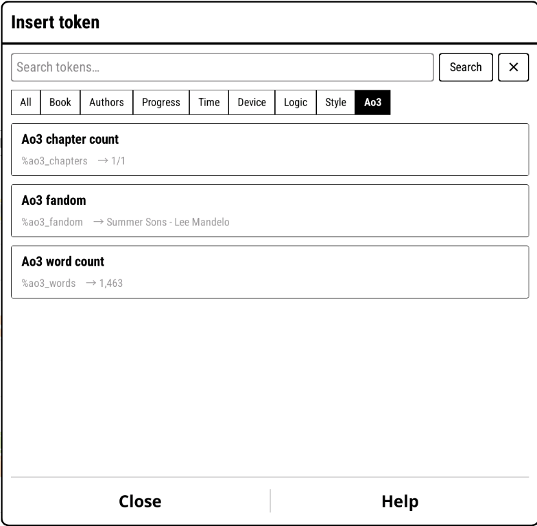
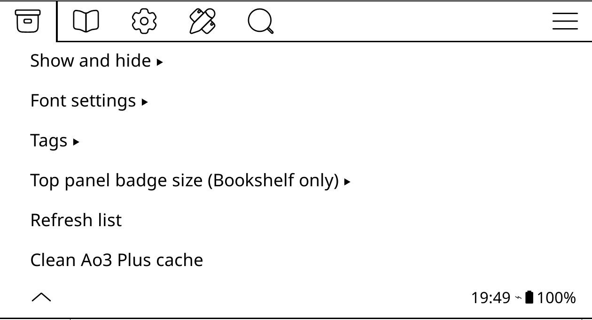

<div align="center">

# Ao3 Plus for KOReader

More Ao3 information in your KOReader fanfiction lists.

</div>

<table>
  <tr>
    <th width="50%">KOReader detailed list</th>
    <th width="50%">Bookshelf</th>
  </tr>
  <tr>
    <td><a href="docs/images/koreader-detailed-list.png"></a></td>
    <td><a href="docs/images/bookshelf-preview.png"></a></td>
  </tr>
</table>

Ao3 Plus displays useful Archive of Our Own information in KOReader without
creating cover images.

It works with:

- KOReader's regular detailed list
- Bookshelf's list view and top panel

Books that already have covers are left alone.

## What it adds

- Rating, pairing/category, warnings and completion badges
- Fandom and tags
- Description
- Word count and chapter count
- Reading progress
- Font and display options
- Extra Bookshelf tokens

> **Important:** Ao3 Plus is made for EPUBs downloaded from Ao3. These files
> contain the information needed to display the badges and details.

You can download works directly from Ao3 or use the
[Ao3 Downloader plugin](https://github.com/IntrovertedMage/AO3Downloader.koplugin).

## Installation

Download this repository, then copy:

- `patches/2-ao3-plus.lua` into KOReader's `patches` folder
- Every PNG from `icons/` into KOReader's `icons` folder

Your KOReader folder should look like this:

```text
koreader/
├── icons/
│   ├── category-*.png
│   ├── complete-*.png
│   ├── rating-*.png
│   └── warning-*.png
└── patches/
    └── 2-ao3-plus.lua
```

Restart KOReader after copying the files.

## Using the regular KOReader list

In the file browser:

1. Select **Detailed list with cover images and metadata**.
2. Set the list to **4 rows**.
3. Open **File browser menu → Ao3 Plus settings**.
4. Select **Refresh list** if the folder was already open.

Four rows give the best balance between the number of books and the space
available for information.

## Using Bookshelf

Ao3 Plus can display badges in Bookshelf's list rows and top panel.

Under **Ao3 Plus settings → Top panel badge size (Bookshelf only)**, choose
**Small (same as list rows)** (the default) or **Large**. Reopen Bookshelf
after changing this setting. List-row badges are unchanged.

When badges replace the cover in the top panel, tap anywhere in the badge
column below KOReader's top menu area. A single tap shows a light grey area
behind the badges, then opens the book. This replaces the
cover-opening animation. Bookshelf's optional two-tap opening setting still
applies if enabled.

## Bookshelf tokens

Ao3 Plus adds these tokens under the **Ao3** section of Bookshelf's token
picker:

| Token | Displays |
|---|---|
| `%ao3_words` | Word count |
| `%ao3_chapters` | Chapter count, such as `12/24` or `12/?` |
| `%ao3_fandom` | Fandom |

<p align="center">
  <a href="docs/images/bookshelf-token-picker.png"></a>
</p>

Examples:

```text
[if:ao3_words]Words: %ao3_words[/if]
[if:ao3_chapters]Chapters: %ao3_chapters[/if]
%ao3_fandom
```

## Settings for Koreader list

Open:

**File browser menu → Ao3 Plus settings**

<p align="center">
  <a href="docs/images/ao3-plus-settings.png"></a>
</p>

Settings are grouped into:

- **Show and hide**: toggle the title, author, fandom, tags, description,
  word and chapter counts, and reading progress
- **Font settings**: choose the font and size for each text section
- **Tags**: choose how many tags are displayed
- **Refresh list**: to see changes
- and **Clean Ao3 Plus cache**: manually prune cache

The default maximum is **15 tags**.

### Scanner and cache

Ao3 Plus reads information directly from your EPUBs. It checks up to the
first four HTML pages inside each EPUB for the Ao3 work information, including
the word count, chapter count and completion status.

The scanner does not change your EPUBs and does not send anything online. It
saves the results in small cache files inside KOReader's `settings` folder:

- `bookshelf_ao3_status_v2.lua` stores completion status
- `ao3_plus_metadata_v1.lua` stores word and chapter counts

This means Ao3 Plus does not need to reopen the same EPUB every time the list
is displayed.

**Clean Ao3 Plus cache** checks both cache files and removes
entries for EPUBs that no longer exist. It does not delete books, reading
progress, tags or settings, and it keeps the cached information for books
that are still on the device. Ao3 Plus also performs this cleanup
automatically from time to time.

### Fonts

Open:

**Ao3 Plus settings → Font settings**

You can choose the font and size used for:

- Titles
- Authors
- Fandom
- Tags
- Descriptions
- Fic data (the bottom line: words, chapters and the progress percentage)

The defaults, also used by **Reset to default**, are:

| Section | Font | Size |
|---|---|---|
| Title | Noto Sans Bold | 18 |
| Authors | Noto Serif Italic | 13 |
| Fandom | Noto Sans Regular | 10 |
| Tags | KOReader's list font | 12 |
| Description | Noto Sans Regular | 13 |
| Fic data | Noto Sans Bold | 12 |

Existing font selections are kept.

## Icons

Ao3 Plus uses Ao3's official 50-pixel
[`default_large` symbols](https://github.com/otwcode/otwarchive/tree/master/public/images/skins/iconsets/default_large).
The source repository is licensed under GPL-2.0-or-later.

## Credits

Huge thank you to [@AndyHazz](https://github.com/AndyHazz) over at [bookshelf.koplugin](https://github.com/AndyHazz/bookshelf.koplugin) for providing me with a hook so I can make this one! For more technical commentary please refer to the patch itself.
